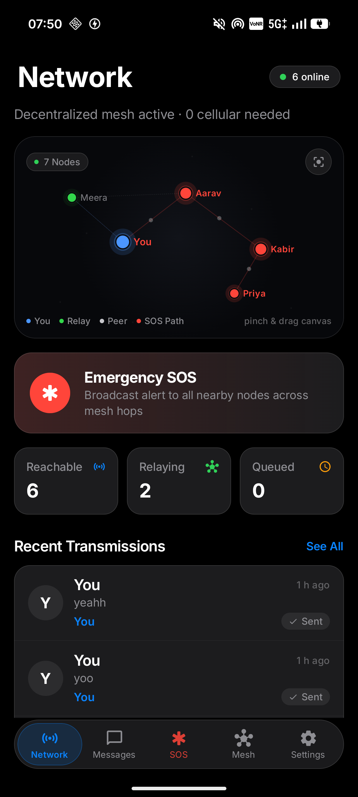
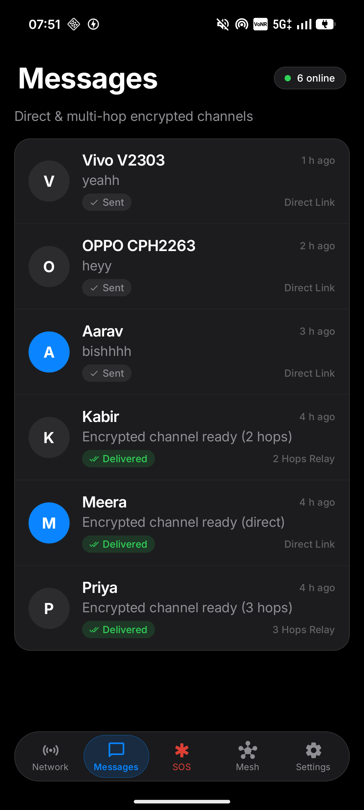
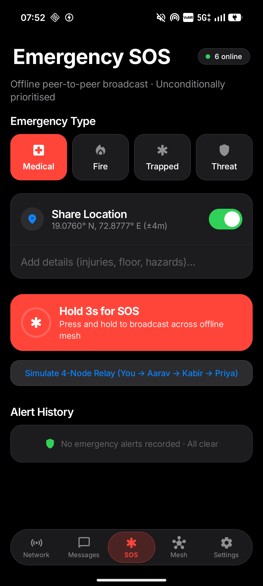
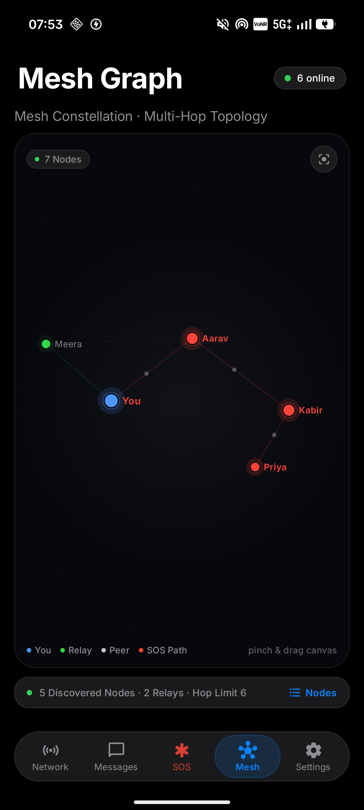
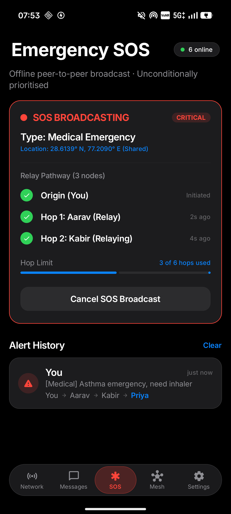
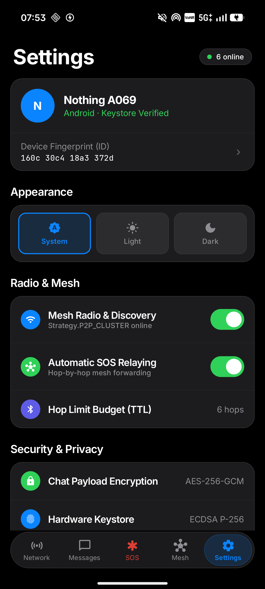

# 🚀 CBIT Hacktoberfest '26 — Project Starter Repository

> **Official Public Starter Repository for CBIT Hacktoberfest '26**  
> *Chaitanya Bharathi Institute of Technology (CBIT), Hyderabad*

---

## 📋 Team Information

| Attribute           | Details                                                                    |
|:------------------- |:-------------------------------------------------------------------------- |
| **Team Name**       | **FLUX** (Project: **Lynq**)                                               |
| **Team Number**     | `TEAM-40` (`HFT26-TEAM-40`)                                                |
| **Registration ID** | `HFEST26-GJ9WMSBH`                                                         |
| **Problem Track**   | **Offline Emergency Messaging System**                                     |
| **Domain**          | `General Track`                                                            |
| **Team Leader**     | G N SREEKAR (sreekargn485@gmail.com)                                       |
| **Institution**     | INSTITUTE OF AERONAUTICAL ENGINEERING                                      |

### 👥 Team Members

| #   | Name                | Email                        | Institution                           |
|:--- |:------------------- |:---------------------------- |:------------------------------------- |
| 1   | KAMEGAONKAR KRUTHIK | kamegaonkarkruthik@gmail.com | INSTITUTE OF AERONAUTICAL ENGINEERING |
| 2   | ASHWIK SAXENA       | saxenaashwik@gmail.com       | INSTITUTE OF AERONAUTICAL ENGINEERING |
| 3   | VVM SAI GANESH      | vvmsaiganesh@gmail.com       | INSTITUTE OF AERONAUTICAL ENGINEERING |

---

## 🎯 Problem Statement: Offline Emergency Messaging System

### *Track:* **General Track — Offline Emergency Messaging System**

During catastrophic disasters (earthquakes, cyclones, extreme flooding) or severe civic blackouts, **cellular base towers, power grids, fiber backbones, and internet infrastructure fail completely**. Victims, isolated communities, and rescue personnel are trapped in communicative blackouts where standard internet and cellular messaging apps (WhatsApp, Telegram, SMS) become entirely useless.

### **Our Solution: Lynq**
**Lynq** is an **offline-first, infrastructure-less emergency communication network for Android**. Without cellular reception, Wi-Fi routers, or specialized satellite gear, nearby standard Android smartphones running Lynq autonomously discover one another via Bluetooth Low Energy and Wi-Fi Direct (using Google Nearby Connections `Strategy.P2P_CLUSTER`) and establish a self-healing **peer-to-peer multi-hop mesh**.

When Device A needs to transmit an alert to distant Device D out of direct radio range, packets travel **hop-by-hop through intermediate devices (A → B → C → D)** with store-and-forward persistence, route history tracing, and cryptographic delivery acknowledgements (ACKs).

---

## 📸 Screenshots & Visual Interface

### 📱 Core Application Flows

| 1. Network Dashboard | 2. Encrypted Messages & Translation | 3. Emergency SOS Broadcaster |
|:---:|:---:|:---:|
|  |  |  |
| *Live mesh status, active hops, quick SOS* | *E2EE chat, multi-language translation, SitRep* | *Hold-to-broadcast, triage categories, GPS* |

| 4. Mesh Topology Explorer | 5. Live SOS Relay Breadcrumbs | 6. Hardware Identity & Settings |
|:---:|:---:|:---:|
|  |  |  |
| *Visual node graph, link metrics, packet paths* | *Multi-hop relay trace (A → B → C → D)* | *Keystore fingerprint, Render backend, TTL* |

### 🖼️ High-Resolution Demo Contact Sheet


---

## 🎥 Demo Video & Verification

The repository includes a full high-definition physical multi-device walkthrough:
- **Local Walkthrough File:** [`docs/lynq-demo-1080p.mp4`](docs/lynq-demo-1080p.mp4)
- **Live Cloud Backend:** [https://lynq-ai-backend.onrender.com](https://lynq-ai-backend.onrender.com) (Health: `/health`)

### Verified Multi-Device Test Criteria:
1. **Direct Offline Messaging**: Real-time communication between directly linked phones over Bluetooth/Wi-Fi Direct.
2. **Multi-Hop Relaying (A → B → C → D)**: Message routed through intermediate nodes with hop limit decrement and route history tagging.
3. **Emergency SOS Propagation**: Priority flooding across all reachable nodes with non-blocking GPS coordinates.
4. **End-to-End Cryptography**: Hardware Keystore EC P-256 + AES-256-GCM verification.
5. **Decoupled AI Situational Reports & Translation**: Live Qwen 2.5 translation into Hindi, Japanese, Bengali, and Spanish without blocking mesh traffic.

---

## 💡 Key Features

- 📡 **Multi-Hop Store-and-Forward Mesh**: Dynamic routing over Google Nearby Connections `Strategy.P2P_CLUSTER`. Packets propagate across intermediary survivor devices until reaching destinations, bounded by a 6-hop TTL budget and seen-set deduplication.
- 🚨 **Priority SOS Broadcast Engine**: High-visibility emergency broadcaster with specialized categories (*Medical, Fire, Rescue / Trapped, Logistics*). Transmits coordinates via non-blocking GPS provider and propagates across all reachable nodes.
- 🔒 **Hardware-Backed Cryptography & Identity**:
  - Device identities derived from Android Keystore EC secp256r1 public key fingerprints (`xxxx xxxx xxxx xxxx`).
  - 1-to-1 chat payloads encrypted end-to-end using AES-256-GCM. Intermediary nodes only route ciphertext without seeing message bodies.
  - SOS alerts carry ECDSA cryptographic signatures for authenticity.
- 🗺️ **Mesh Topology Explorer**: Live interactive visualization displaying node distances, active peer links, signal strengths, and multi-hop route breadcrumbs (e.g. `You → Aarav → Priya → Shelter`).
- 🤖 **Decoupled Crisis Intelligence (FastAPI + Featherless AI)**:
  - **Zero-Block Design**: Mesh routing and SOS broadcasting operate 100% offline and never block or depend on cloud services.
  - **Situational Reports (SitRep)**: Synthesizes chat threads into triage levels (`CRITICAL`, `HIGH`, `NORMAL`, `SAFE`), extracted key facts, and actionable responder advice.
  - **Live Crisis Translation**: On-demand translation across 8 languages (Hindi, Japanese, Bengali, Spanish, French, German, Arabic, English) powered by `Qwen/Qwen2.5-7B-Instruct` on Featherless AI.
  - **Server-Side Key Security**: Hosted on Render with backend environment variables—no client API key required on user devices.

---

## 🏗️ Architecture & Message Flow

```
┌────────────────────────────────────────────────────────────────────────┐
│                        Jetpack Compose UI                              │
│   Dashboard  │  Messages  │  Emergency SOS  │  Mesh Explorer  │ Settings│
└───────────────────────────────────┬────────────────────────────────────┘
                                    │ ViewModels (StateFlow)
┌───────────────────────────────────▼────────────────────────────────────┐
│                             Lynq Engine                                │
│       MessageRouter  ·  PriorityQueue  ·  DeliveryStatusManager        │
└───────────────┬───────────────────────────────────────┬────────────────┘
                │                                       │
┌───────────────▼───────────────┐       ┌───────────────▼────────────────┐
│         NearbyManager         │       │          LynqDatabase          │
│   Strategy.P2P_CLUSTER        │       │  SQLite Messages, Peers, Queue │
│   Advertise / Discover / Send │       │  Seen-Set Deduplication Cache  │
└───────────────┬───────────────┘       └────────────────────────────────┘
                │
┌───────────────▼───────────────┐       ┌────────────────────────────────┐
│         CryptoManager         │       │ (Optional Cloud Gateway)       │
│  Android Keystore EC P-256    │       │ FastAPI Backend on Render      │
│  E2EE (AES-256-GCM)           │       │ └─► Featherless AI (Qwen 2.5)  │
└───────────────────────────────┘       └────────────────────────────────┘
```

### Hop-by-Hop Multi-Hop Relay Flow

```
[Device A (Origin)]
      │  Creates LynqMessage (TTL=6, Route=[A])
      ▼
   (Bluetooth / Wi-Fi Direct Link)
      ▼
[Device B (Relay)]
      ├─► Dedupe Check: Is messageId in SeenSet? (No -> Add to SeenSet)
      ├─► TTL Decrement: TTL=5, Route=[A, B]
      └─► Forward to all connected peers except sender (A)
      ▼
   (Bluetooth / Wi-Fi Direct Link)
      ▼
[Device C (Relay)]
      ├─► Dedupe & TTL Decrement (TTL=4, Route=[A, B, C])
      └─► Forward to Device D
      ▼
[Device D (Recipient)]
      ├─► Dedupe Check & Decrypt AES-256-GCM payload
      ├─► Trigger local audio/visual alert
      └─► Dispatch ACK packet back along route (D → C → B → A)
```

---

## 🛠️ Tech Stack

| Area | Choice | Description |
|:---|:---|:---|
| **Language** | Kotlin & Python | Modern Kotlin 2.x for Android client; Python 3.11 for AI backend |
| **Android UI** | Jetpack Compose | Material 3 custom Apple/Dark Command theme |
| **P2P Transport** | Google Nearby Connections | `Strategy.P2P_CLUSTER` (simultaneous BLE + Wi-Fi Direct mesh) |
| **Local Storage** | Room SQLite | Persisted messages, peers, pending queue, and seen-set dedupe |
| **Asynchronous** | Coroutines & StateFlow | Reactive non-blocking UI pipelines and background routing |
| **Cryptography** | Android Keystore | EC secp256r1 hardware keys + AES-256-GCM encryption |
| **Location** | Fused Location Provider | Optional, non-blocking GPS embedding in SOS alerts |
| **AI Backend** | FastAPI + Uvicorn | Async Python microservice hosted on Render |
| **LLM Inference** | Featherless AI | `Qwen/Qwen2.5-7B-Instruct` (ungated, multilingual translation) |

---

## 📁 Project Structure

```
Lynq/
├── app/                                    # Android application module
│   ├── src/main/
│   │   ├── AndroidManifest.xml
│   │   └── java/com/sunless/lynq/
│   │       ├── ai/                         # Featherless AI client, preferences & languages
│   │       │   ├── AiModels.kt
│   │       │   ├── AiPreferences.kt
│   │       │   └── FeatherlessAiClient.kt
│   │       ├── crypto/                     # Keystore & AES-256-GCM encryption
│   │       │   └── CryptoManager.kt
│   │       ├── data/                       # Room SQLite database, DAOs & entities
│   │       ├── domain/                     # Domain models (LynqMessage, Peer, Priority)
│   │       │   └── model/
│   │       ├── engine/                     # Routing engine, TTL & deduplication
│   │       │   ├── MessageRouter.kt
│   │       │   └── PriorityQueue.kt
│   │       ├── network/                    # Google Nearby Connections P2P_CLUSTER wrapper
│   │       │   └── NearbyManager.kt
│   │       ├── service/                    # Background mesh foreground service
│   │       └── ui/                         # Jetpack Compose screens, components & theme
│   │           ├── screens/                # Dashboard, Messages, Emergency, Explorer, Settings
│   │           ├── components/             # Apple-style cards, chips, topology canvas
│   │           └── theme/                  # Color palette, typography, shape styles
│   └── build.gradle.kts
├── backend/                                # Decoupled FastAPI AI Intelligence Service
│   ├── main.py                             # Summarize, Translate, Triage & Proxy endpoints
│   ├── requirements.txt                    # FastAPI, Uvicorn, httpx, pydantic
│   └── .env.example
├── docs/                                   # Architectural diagrams, specifications & media
│   ├── architecture.md
│   ├── networking.md
│   ├── PROGRESS.md
│   ├── screenshots/                        # Core UI flow screenshots
│   └── lynq-demo-1080p.mp4                 # Walkthrough video
├── render.yaml                             # 1-Click Render Blueprint autodeploy manifest
├── build.gradle.kts
└── README.md
```

---

## 🚀 Getting Started & Installation

### 1. Android Application

#### Prerequisites
- Android Studio Ladybug / Meerkat (or newer)
- Android SDK 35 (Min SDK: 26 / Android 8.0 Oreo)
- Real Android devices with Bluetooth and Wi-Fi enabled (Google Play Services required)

#### Build & Run
```bash
# Clone the repository
git clone https://github.com/cbitosc/HFT26-TEAM-40.git
cd HFT26-TEAM-40

# Build debug APK
./gradlew assembleDebug

# Install on connected device via ADB
adb install -r app/build/outputs/apk/debug/app-debug.apk
```

---

### 2. FastAPI Intelligence Backend

#### Local Setup
```bash
cd backend
python -m venv .venv
source .venv/bin/activate    # On Windows: .venv\Scripts\activate
pip install -r requirements.txt

# Configure your Featherless API key
cp .env.example .env
# Edit .env with your FEATHERLESS_API_KEY

uvicorn main:app --host 0.0.0.0 --port 8000 --reload
```

#### 1-Click Render Cloud Deployment
The repository includes an autodeploy [`render.yaml`](render.yaml) Blueprint:
1. Navigate to [dashboard.render.com/blueprints](https://dashboard.render.com/blueprints).
2. Click **New Blueprint Instance** and connect this repository.
3. Supply your `FEATHERLESS_API_KEY` when prompted.
4. Render builds and launches the live FastAPI service with managed HTTPS (e.g. `https://lynq-ai-backend.onrender.com`).

---

## 🛠️ Contribution & Submission Workflow

All teams must follow the official fork-and-pull-request workflow:

1. **Fork this Repository**:
   - One team member should click the **Fork** button at the top right to fork this upstream repository to your personal/team GitHub account.
2. **Add Collaborators**:
   - In your forked repository, navigate to **Settings > Collaborators** and invite all your registered team members.
3. **Clone & Develop Locally**:
   ```bash
   git clone https://github.com/<your-username>/HFT26-TEAM-40.git
   cd HFT26-TEAM-40
   git checkout -b feature/prototype
   ```
4. **Commit & Push Regularly**:
   - Make atomic, descriptive commits throughout the hackathon:
   ```bash
   git add .
   git commit -m "feat(mesh): implement store-and-forward TTL deduplication"
   git push origin feature/prototype
   ```
5. **Open Pull Request (PR) for Final Submission**:
   - When ready for evaluation, open a **Pull Request** from your fork's `main` branch back to this upstream repository's `main` branch.
   - **PR Title Format**: `[SUBMISSION] TEAM-40 - FLUX - Offline Emergency Messaging System`
   - **PR Description Checklist**:
     - 📌 Solution Overview & Approach
     - 🏗️ Architecture & Tech Stack Details
     - 🚀 Local Setup & Installation Instructions
     - 🎥 Demo Video Link / Live Deployment URL
     - 📸 Key Screenshots & Visuals

---

## 🔒 Security & Privacy

- **No Link-Only Trust**: Per-link Nearby Connections encryption is not end-to-end. Lynq enforces application-layer AES-256-GCM encryption from the original sender directly to the final recipient.
- **Intermediary Isolation**: Intermediate relays only forward ciphertext payloads and routing headers (`messageId`, `ttl`, `routeHistory`). They cannot decrypt chat bodies.
- **Open SOS Transparency**: SOS broadcasts remain unencrypted by design so all civilian relays and first responders can read triage info immediately without key exchange; authenticity is verified by the sender's ECDSA signature.
- **Zero Secrets in APK**: The Android application contains zero API keys or secrets. Featherless AI authentication is managed securely server-side on Render.

---

## ⚠️ Important Rules & Code of Conduct

* **Upstream Protection**: Do not push directly to this repository's main branch. All evaluation will be conducted on your submitted Pull Request.
* **Original Work**: All code submitted was developed during the hackathon timeline. Open-source libraries and frameworks are welcomed with proper attribution.
* **Code Freeze**: Final Pull Requests must be submitted before the designated hackathon submission deadline.
* **Offline Limitations Notice**: Lynq is a local peer-to-peer ad-hoc relay system. It enables communication across participating devices within radio relay reach and does not claim to dial public 911/112 cellular networks without an internet-connected gateway node.
